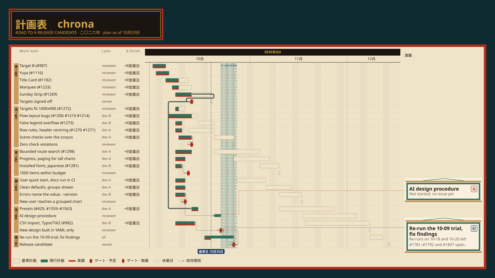
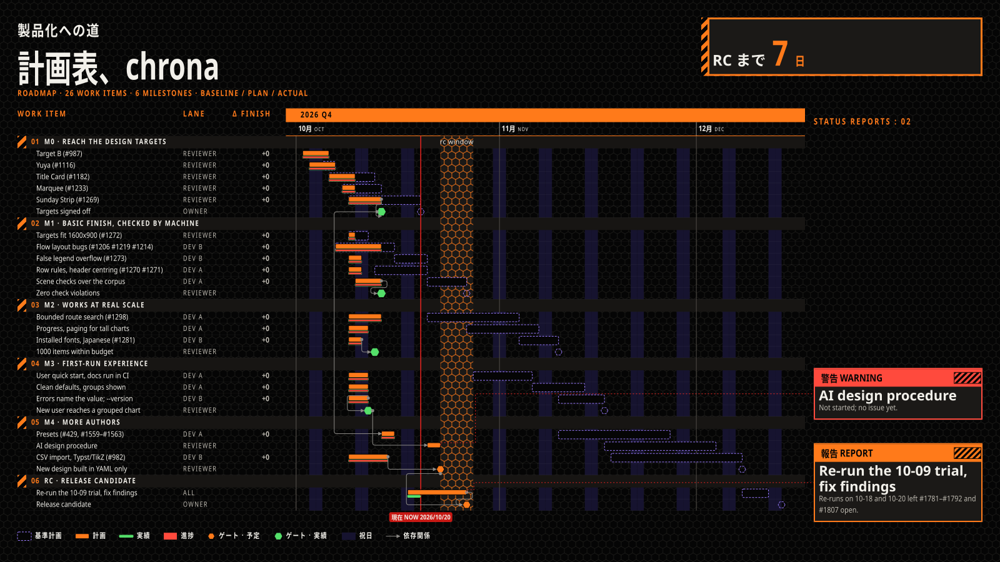
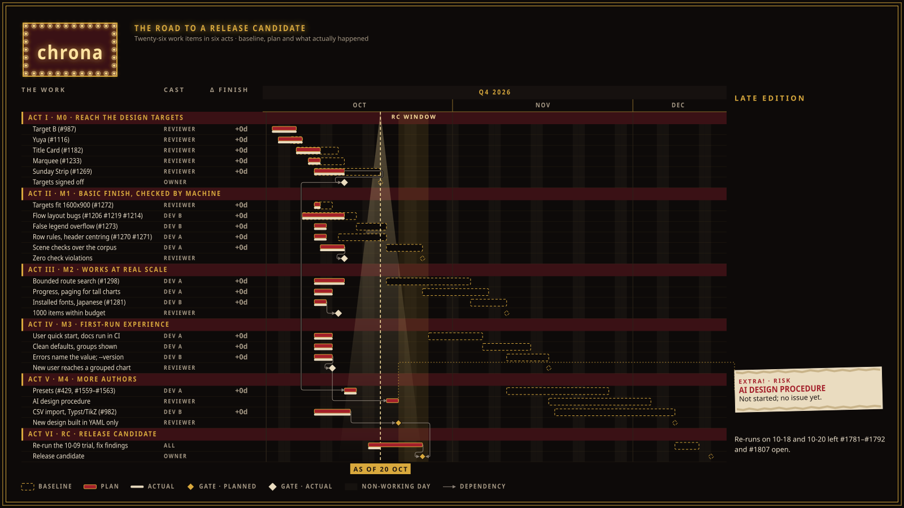
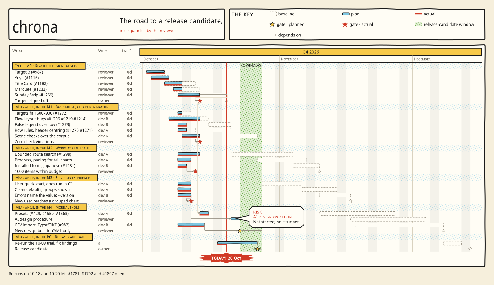

# Chrona

**Chrona** turns a YAML project file into a presentation-grade Gantt slide.
Define the plan, pick a design, render SVG, PNG, PDF, Typst or TikZ. Dependencies and
working calendars decide the dates, and the data decides the layout, so the
chart is never drawn by hand.

The plan stays the source of truth. A renderer consumes it and never owns it,
so any slide can be regenerated from the data that produced it.

### Where chrona fits

A capable designer, human or language model, can draw one beautiful Gantt slide
by hand. Chrona is for the plan that keeps changing after that slide is drawn.

| Drawn by hand | Rendered by chrona |
| --- | --- |
| Redrawn for every slipped date or new task | Re-rendered from the updated plan |
| Dates, deltas and dependency lines placed by eye | Computed from the schedule, the as-of date and the actuals |
| Collisions and illegible text go unnoticed | Suppressed labels, overflows and contrast failures are reported as diagnostics |
| A new picture on every run | Every revision drawn in the same design |
| One slide's look | A Theme and preset shared across every plan and team |

The two work together: **a designer or an agent designs the look once, and
chrona applies it to every revision of the plan.** A hand-drawn target becomes
a Theme, a preset and an asset catalogue. An agent can write the Project and
View YAML, and chrona validates and renders it.

This repository contains the living, versioned Chrona specification and reference
implementations for the accepted delivery milestones. Core v0.1 remains the stable
Date-only scheduling profile; successor DateTime, capacity, collaboration, and
presentation capabilities are opt-in versioned profiles rather than changes to
Date-only meaning.


<sup>Rendered by Chrona from [`examples/chrona-roadmap`](examples/chrona-roadmap), chrona's own
roadmap, in the target B design (View, Theme and Layout YAML only). Each update to the plan or
to the issue dates re-renders it.</sup>

<p>




</p>

<sup>The same roadmap data in four designs (Yuya, Title Card, Marquee, Sunday Strip), no design
copied: each slide is a thin View and Context that reference the packaged designs.</sup>

## What is usable today

- plans written as Project YAML, a terse one-line-per-task plan (`.chrona`), or imported from a
  CSV/TSV table (`chrona import`);
- Date / CalendarPeriod / WorkPeriod arithmetic, working calendars, dependency lower bounds and
  Date-only scheduling, with JSON-Schema and Core v0.1 semantic validation;
- Plan/Actual review slides with baseline, plan, actuals, finish deltas, gates, periods, an as-of
  marker, a notes rail and a YAML-controlled legend, rendered to SVG, PNG, PDF, Typst or TikZ;
- built-in designs selectable by name (`chrona preset list`), including the target B, Marquee and
  Sunday Strip designs shown above; a design is Theme, Color Scheme and Layout YAML, and a View
  connects it to a project;
- dependency lines that never disappear silently: a route that cannot be found is relaxed, drawn
  over, stubbed or suppressed as the Layout declares, with a diagnostic;
- fonts installed on the machine, chosen by the Theme's font family list;
- diagnostics for suppressed labels, overflows and contrast failures;
- executable conformance checks for the canonical Core v0.1 fixture;
- the plan-update loop (actuals, `asOf`, re-plan, compare with the saved plan) in the
  [update-a-plan guide](docs/guides/update-a-plan.md);
- a tested agent skill, installed with `chrona skill copy`, that teaches an AI coding
  agent this workflow, and an MCP server (`chrona mcp`, optional `chrona[mcp]` extra; read-only unless started with `--allow-write`) for
  hosts that have no shell (see [Using chrona from an AI coding agent](docs/guides/agent-interface.md)).

## Quick start

Install chrona with the renderer, create a small editable project and render its first slide
(the output suffix selects the format; use `.png` for a PNG):

```bash
python -m pip install '.[render]'
chrona init my-chrona-project
chrona render my-chrona-project/project.yaml --actual my-chrona-project/actual.yaml \
  --viewport 1600xauto --output my-chrona-project/plan.svg
chrona render my-chrona-project/project.yaml --actual my-chrona-project/actual.yaml \
  --viewport 1600xauto --output my-chrona-project/plan.png
```

The PNG is 1600 px wide at 1x. For more pixels, either render with a wider viewport (`--viewport 3200xauto` gives a 3200 px
PNG laid out afresh, so text stays the same size and gains room), or magnify the finished SVG, which keeps the layout
(`resvg_py` is installed with the `render` extra; `zoom=2` doubles every size):

```bash
python -c "import pathlib, resvg_py; pathlib.Path('my-chrona-project/plan@2x.png').write_bytes(resvg_py.svg_to_bytes(svg_path='my-chrona-project/plan.svg', zoom=2))"
```

`resvg_py` draws text with the fonts installed on the machine. A slide with Japanese text on a machine without a
Japanese font comes out as empty boxes. Give `resvg_py` the Noto Sans JP files of the `packages/chrona-fonts-noto-cjk`
package (install it from a clone, as for the HALCYON example below) with `font_dirs`:

```bash
python -c "import pathlib, resvg_py, chrona_fonts_noto_cjk as cjk; pathlib.Path('my-chrona-project/plan@2x.png').write_bytes(bytes(resvg_py.svg_to_bytes(svg_path='my-chrona-project/plan.svg', zoom=2, font_dirs=[str(cjk.resource_root() / 'fonts')])))"
```

The Today marker (the `as of` line) is drawn only when you pass an Actual Set with `asOf` (`--actual`, as above); without one
the slide has no Today marker.

The resulting SVG is a Draft for review, not immutable materializer evidence. The three generated
source files are yours to edit. Pick a built-in design by name with `--preset` (`chrona preset list`
shows them, `chrona preset copy` copies one to edit), or pass a preset YAML path; explicit
View/Theme/Color Scheme/Layout paths override its members:

```bash
chrona preset list
chrona render my-chrona-project/project.yaml --actual my-chrona-project/actual.yaml \
  --preset marquee --viewport 1600xauto --output my-chrona-project/marquee.svg
```

Check your own plan with `chrona validate` and `chrona schedule`:

<!-- chrona:doc-check skip: requires an author-provided Project path -->
```bash
chrona validate path/to/project.yaml
chrona schedule path/to/project.yaml
python -m chrona validate path/to/project.yaml
```

After a week of work, record actuals, move `asOf`, re-plan and compare with the plan you started
from: [Update a plan](docs/guides/update-a-plan.md). The same loop is a section of the agent
skill (`chrona skill copy`).

### How do I...

| I want to... | Read |
| --- | --- |
| make my first plan and change its title, colour, legend or window | [First project](docs/guides/first-project.md) |
| learn Project features one small step at a time | [Progressive project tutorial](docs/guides/progressive-project-tutorial.md) |
| write a plan quickly, one line per task | [Terse plan card](docs/guides/terse-plan.md), and [what it compiles to](docs/guides/terse-plan-mapping.md) |
| start from a spreadsheet, or colour bars by an owner column | [Import a CSV](docs/guides/csv-import.md) |
| show a dependency graph instead of a timeline | [Network view](docs/guides/network-view.md) |
| make a one-page summary for a steering committee | [Executive summary](docs/guides/executive-summary.md) |
| colour by my own typed field (risk, team) | [Typed fields](docs/guides/typed-fields.md) |
| point a field at a deliverable or a person, and show its title | [objectReference](docs/guides/object-reference.md) |
| build a deck of slides from one manifest, with a baseline | [Deck manifest](docs/guides/deck-manifest.md) |
| record progress, move `asOf` and re-plan | [Update a plan](docs/guides/update-a-plan.md) |
| render in Japanese or reword the built-in texts | [Locale and wording](docs/guides/locale-and-wording.md) |
| choose and embed fonts | [Declared font assets](docs/guides/declared-font-assets.md) |
| look up a command or option | [CLI reference](docs/guides/cli-reference.md) |
| let an AI coding agent draft the plan | [Agent interface](docs/guides/agent-interface.md) |
| organize View, Theme and Layout files for render-review | [Render-review YAML layout](docs/guides/render-review-yaml-layout.md) |
| recover from a rejected guided-authoring command | [Revision recovery](docs/guides/guided-authoring-revision-recovery.md) |
| move or migrate a local store | [Local-store compatibility](docs/guides/local-store-compatibility.md) |
| browse the public examples as a learning path | [Example curriculum](docs/guides/example-curriculum.md), and [corpus policy](docs/guides/corpus-policy.md) |
| change chrona's own source | [Source architecture](docs/guides/source-architecture.md) |

To work on chrona itself, see [Develop chrona](CONTRIBUTING.md#development-setup).

Draft rendering defaults to a content-sized `1600xauto` viewport. Use an
explicit `--viewport WIDTHxHEIGHT` when you need a finite minimum allocation.
The `auto` request is Draft-only; immutable Render Contexts keep a finite
`environment.viewport.blockSize`.

On Windows, `python -m chrona` is equivalent to the installed `chrona` command
and avoids depending on the virtual environment's `Scripts` directory being on
`PATH`. Contributors should retain the repository's `.gitattributes`; it pins
LF checkout bytes for identity-bound YAML, JSON, SVG, and schema resources.

`validate` and `schedule` also accept an immutable local snapshot instead of a
raw Draft path:

<!-- chrona:doc-check skip: requires an author-created immutable snapshot reference and local store -->
```bash
chrona schedule \
  --snapshot-reference project-reference.yaml \
  --snapshot-root .chrona/snapshots \
  --store-identity local-workspace
```

`chrona render-review` consumes only an immutable Render Context v0.8 reference. Theme,
Layout, View, optional detail/summary inputs, viewport and Font Metrics are closed by that
Context before layout or Scene construction.

`chrona schedule` is a reference implementation for the acyclic Date-only
subset. It reports diagnostics for unsupported cycles rather than treating all
cycles as semantic errors.

`chrona render` is the first derived presentation slice: it projects the
resolved placements into a deterministic SVG timeline. SVG coordinates are not
project data and are never used to schedule or validate a project.

Try the plan-only controller example (these commands read `examples/` and need a clone of the repository). `render` deliberately requires
every presentation input explicitly; omit `--actual` because this View declares
it optional:

<!-- chrona:doc-check requires: clone the example inputs live under examples/ and are not part of the wheel -->
```bash
chrona render examples/controller-z/project.yaml \
  --view examples/controller-z/views/plan-only.yaml \
  --theme examples/controller-z/themes/executive-light.yaml \
  --scheme examples/controller-z/schemes/executive-light.yaml \
  --layout examples/controller-z/layouts/executive-review.yaml \
  --output controller-z-plan.svg
```

For a broader semiconductor bring-up example with fixed and scheduled spans, working-day
exceptions, endpoint dependencies, parallel qualification work, gates, entities,
annotations, and observations, add the executive View and Actual Set:

<!-- chrona:doc-check requires: clone the example inputs live under examples/ and are not part of the wheel -->
```bash
chrona render examples/controller-z/project.yaml \
  --view examples/controller-z/views/executive.yaml \
  --theme examples/controller-z/themes/executive-light.yaml \
  --scheme examples/controller-z/schemes/executive-light.yaml \
  --layout examples/controller-z/layouts/executive-review.yaml \
  --actual examples/controller-z/actual.yaml \
  --output controller-z.svg
```

## Presentation slides

A Plan/Actual review surface is rendered from a materialized v0.8 Context:

<!-- chrona:doc-check skip: requires an author-created immutable Render Context reference and local store -->
```bash
chrona render-review \
  --context-reference context-reference.yaml \
  --snapshot-root .chrona/snapshots \
  --store-identity local-workspace \
  --output executive.svg
```

Reusable authoring files live under `views/`, `themes/`, `layouts/`, and optional
`profiles/`. A different Theme changes concrete visual tokens; a different Layout changes
composition without changing selected facts.

For a deck, generate one v0.8 Context per view while binding the same immutable Project,
Actual, Theme and Layout resources. `examples/aster-ssd/manifest.yaml` lists that reuse;
`contexts/01-overview.yaml` shows one generated binding. Render every Context through the
same `chrona render-review` command so scheduling and presentation facts cannot drift.

[`examples/aster-ssd`](examples/aster-ssd) is the worked example: a 24-object,
28-dependency program across two work calendars, projected into four 1600x900
slides plus a tall master view.

## Local authoring

### Terse plans

A terse plan (`plan.chrona`) is the quickest way to draft a schedule: one line per task, gate or group, with
dependencies as a clause on the line. `chrona validate`, `schedule` and `render` accept it directly, and
`chrona compile` writes the Project YAML once the plan is final (the YAML is the source from then on). The
[one-page card](docs/guides/terse-plan.md) has the whole syntax.

```chrona
project my-plan "My plan"
design "Design" task 2026-10-01..2026-10-15
build "Build" task 3w after design
release "Release" gate 2026-11-20 after build
```

<!-- chrona:doc-check skip: requires an author-provided plan file -->
```bash
chrona render plan.chrona --output plan.svg
```

### Portable icons

Create a catalog from an explicit local Iconify collection, then pass that
catalog explicitly to draft rendering. The catalog is normalized before render;
Chrona never reads raw SVG or contacts a registry at render time.
The importer writes deterministic JSON (a YAML subset) to the requested
`.yaml` path, so it remains valid YAML while large catalogs load quickly.

<!-- chrona:doc-check skip: requires an author-provided Iconify collection, notice file, and matching draft resources -->
```bash
chrona icon-catalog import icons.json --license-spdx MIT --notice-file NOTICE \
  --output icons.yaml
chrona render project.yaml --view view.yaml --theme theme.yaml --scheme scheme.yaml \
  --layout layout.yaml --icon-catalog icons.yaml \
  --visual-profile chrona-output/visual/v0.7-svg --output review.svg
```

A declarative Theme asset source can instead provide licensed glyphs and
patterns; its SPDX identifier and complete notice travel in the catalog.

<!-- chrona:doc-check skip: requires an author-provided theme-asset-source YAML -->
```bash
chrona icon-catalog import --theme-assets assets.yaml --output assets-catalog.yaml
```

In the View, attach a catalog entry to an existing target. `decorative: false`
requires the catalog alternative and retains the existing text as equivalent
meaning:

```yaml
visuals:
  - target: {kind: title}
    ref: chrona:risk
    side: leading
    decorative: false
```

See [Specification 64](docs/specification/64-portable-icon-catalogs.md) and
[Controller Z's icon Context](examples/controller-z/contexts/icons.yaml) for a
fully pinned materialized example.

The HALCYON example is available from an installed wheel.
Slides requiring an absent font provider are omitted with typed warnings; the other
slides remain materializable. For every Japanese slide, install the unpublished
`packages/chrona-fonts-noto-cjk` package from a clone and initialize a new directory.

```bash
chrona init my-halcyon-example --example halcyon-1
chrona materialize my-halcyon-example/manifest.yaml \
  --slide mission-brief --output my-halcyon-example/out
```

`init` refuses a non-empty target. The HALCYON example keeps its immutable
Store closure under `.chrona/store`; commands that use a configured Store
prefer an explicit `--store-config`, otherwise discover `.chrona/store.yaml`
by walking upward from the current project directory. No home-directory or
broad filesystem fallback is used.

`init --example` writes `integrity: optional` into that Store config, with a comment
saying why: the example Contexts leave inner references unpinned by design
(ADR-0030). The plain `chrona init` and every other Store keep content identity
`required`. [First project](docs/guides/first-project.md#render-an-example-context-from-its-store)
shows rendering an example Context from this Store with `render-review --store-config`.

On success `chrona materialize` prints the same `{"status", "diagnostics", "warnings"}` JSON as `chrona render`, and
resolves each Theme font stack the same way (declared, installed or packaged faces, #1281).

Materialization verifies declared generated evidence. If a reviewed source
change intentionally changes that artifact, rerun the same `chrona materialize`
command with `--write` to refresh it; without that explicit flag, a mismatch is
rejected.

## Specification

The current specification set is maintained in [`docs/specification/`](docs/specification/).
Public schemas live in [`schemas/`](schemas/) and executable compatibility fixtures in
[`conformance/`](conformance/). Git history and versioned manifests preserve earlier
candidates. Start with:

1. [`docs/specification/00-vision.md`](docs/specification/00-vision.md)
2. [`docs/specification/03-temporal-model.md`](docs/specification/03-temporal-model.md)
3. [`docs/specification/04-scheduling-model.md`](docs/specification/04-scheduling-model.md)
4. [`docs/specification/05-project-format.md`](docs/specification/05-project-format.md)
5. [`docs/specification/17-implementation-delivery-profile.md`](docs/specification/17-implementation-delivery-profile.md)

Core v0.1 is Stable. Implementation discoveries are recorded through diagnostics,
ADRs, and design-first remediation before implementation changes.

## Contributing and security

See [CONTRIBUTING.md](CONTRIBUTING.md) for the design-first workflow and verification
requirements, [SECURITY.md](SECURITY.md) for private vulnerability reporting, and
[CHANGELOG.md](CHANGELOG.md) for notable changes.

## License

No license has been selected yet.  Do not treat this project as licensed for
reuse until a `LICENSE` file is added.
