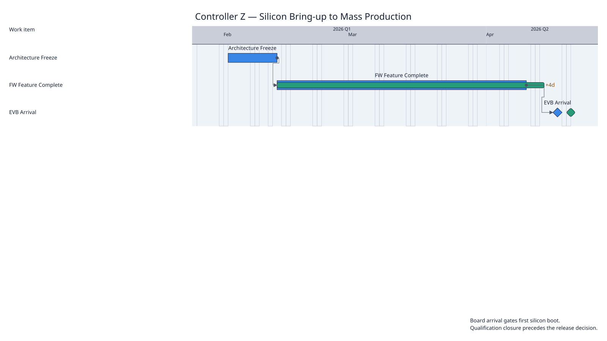

# comparison focus

Generated by `tools/render_design_gallery.py --root .`.

Design Space dimension: `content`.

## Peers

### Executive status

Compare plan


Corpus: `controller-z` · slide: `executive` · [Context](../../../examples/controller-z/contexts/executive.yaml)

### Plan-only control

Focus the same schedule on planned commitments.



Corpus: `controller-z` · slide: `plan-only` · [Context](../../../examples/controller-z/contexts/plan-only.yaml)

## Presentation-reference diff

- `view`: `controller-z-executive` → `controller-z-plan-only`

## Referenced-resource YAML diff

The pair changes only `view`.

```diff
--- executive.yaml
+++ plan-only.yaml
@@ -19,7 +19,6 @@
       label:
         align: start
         form: short-month
-        nameTable: en-US
         orientation: horizontal
         overflow: thin-with-record
       role: labels
@@ -29,39 +28,29 @@
       unit: month
   backgroundDecoration:
     groups: all
-    rows: alternate
+    rows: none
   comparison:
-    actual: required
+    actual: optional
     baseline: primary
     deltaUnit: calendar-days
     facets:
     - planned
-    - actual
-    - finishDelta
-    - atDelta
-    - progress
-    - missingActual
-    - unmatchedActual
     observationSelection: latest
   grouping:
-    by: field
-    field: owner
+    by: none
     missing: ungrouped
-    order:
-    - fw-team
-    - validation-team
-    - factory-team
-    presentation: header
   ordering:
     by: plannedStart
     direction: ascending
     tieBreak: id
-  progressFill:
-    source: actual
   rows:
     mode: automatic
   selection:
     include:
+      ids:
+      - architecture
+      - firmware
+      - evb-arrival
       types:
       - span
       - point
@@ -69,7 +58,7 @@
   tableColumns:
   - align: start
     headerOrientation: horizontal
-    id: Workstream
+    id: Work item
     missing: em-dash
     source: title
     width:
@@ -79,27 +68,13 @@
         min: content
   visibility:
     annotations: none
-    fallback:
-      labels:
-      - inside
-      - above
-      - suppress
-    labels:
-      content:
-      - title
-      overflow: suppress
-      placement: plot
-      side: inside
+    labels: true
     relations:
-      content:
-      - lag
-      - endpointPair
       mode: semantic
       overflow: suppress
   window:
-    end: '2026-07-01'
-    mode: explicit
-    start: '2026-02-01'
-id: controller-z-executive
+    marginDays: 7
+    mode: selected-planned
+id: controller-z-plan-only
 kind: view
 version: chrona/view/v0.27


## Accessibility

- Executive status: Semantic labels and table structure remain present alongside colour.
- Plan-only control: Semantic labels and table structure remain present alongside colour.
