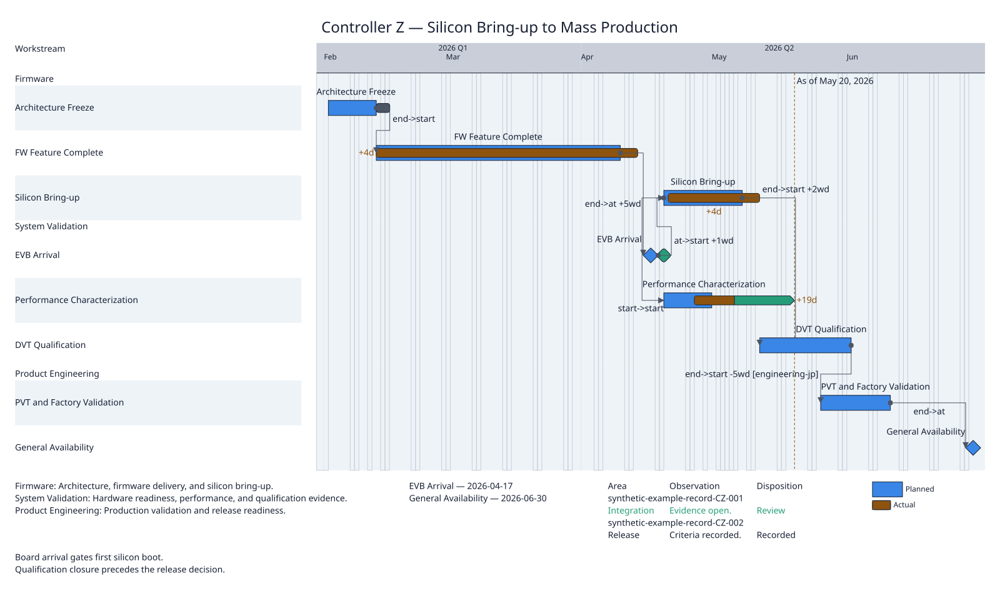
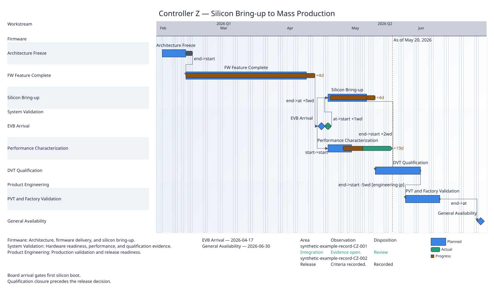

# visual treatment

Generated by `tools/render_design_gallery.py --root .`.

Design Space dimension: `appearance`.

## Peers

### Baseline treatment

Establish the ordinary status-review treatment.



Corpus: `controller-z` · slide: `executive` · [Context](../../../examples/controller-z/contexts/executive.yaml)

### Elevated status review

Compare bounded portable visual treatment on the same review.



Corpus: `controller-z` · slide: `elevated` · [Context](../../../examples/controller-z/contexts/elevated.yaml)

## Presentation-reference diff

- `theme`: `executive-light` → `elevated-light`

## Referenced-resource YAML diff

The pair changes only `theme`.

```diff
--- executive-light.yaml
+++ elevated-light.yaml
@@ -2,21 +2,6 @@
   colorBindings:
     actual.fill: positive
     actual.stroke: text
-    annotation-arrow-box.fill: surfaceRaised
-    annotation-arrow-box.stroke: negative
-    annotation-arrow-leader.stroke: negative
-    annotation-arrow-text.fill: text
-    annotation-callout-box.fill: surfaceRaised
-    annotation-callout-box.stroke: neutral
-    annotation-callout-leader.stroke: textMuted
-    annotation-callout-text.fill: text
-    annotation-highlight-box.fill: surface
-    annotation-highlight-box.stroke: accent
-    annotation-highlight-text.fill: text
-    annotation-note-box.fill: surfaceRaised
-    annotation-note-box.stroke: warning
-    annotation-note-leader.stroke: warning
-    annotation-note-text.fill: text
     annotation.fill: surfaceRaised
     as-of.stroke: warning
     axis-band-decoration.fill: neutral
@@ -29,6 +14,9 @@
     critical-edge.stroke: negative
     dependency.stroke: textMuted
     group-band.fill: category:default
+    group-band.gradientEnd: surface
+    group-band.gradientStart: surfaceRaised
+    group-band.shadowColor: neutral
     group-header-band.fill: surfaceRaised
     group:factory-team.fill: category:factory-team
     group:fw-team.fill: category:fw-team
@@ -44,7 +32,7 @@
     network-edge.stroke: textMuted
     network-node.fill: surfaceRaised
     network-node.stroke: text
-    note-index.fill: textMuted
+    note-index.fill: accent
     planned.fill: accent
     planned.stroke: text
     progress-fill.fill: warning
@@ -90,55 +78,6 @@
       lineHeight: annotation-line-height
       numericSpacing: numeric-spacing
       textTransform: text-transform
-    annotation-arrow-box:
-      strokeWidth: stroke-width
-    annotation-arrow-leader:
-      marker: annotation-arrow-terminal
-      strokeWidth: stroke-width
-    annotation-arrow-text:
-      fontFamily: editorial
-      fontSize: annotation-size
-      fontWeight: text-weight
-      letterSpacing: letter-spacing
-      lineHeight: annotation-line-height
-      numericSpacing: numeric-spacing
-      textTransform: text-transform
-    annotation-callout-box:
-      strokeWidth: stroke-width
-    annotation-callout-leader:
-      dash: dash.leader
-      strokeWidth: stroke-width
-    annotation-callout-text:
-      fontFamily: editorial
-      fontSize: annotation-size
-      fontWeight: text-weight
-      letterSpacing: letter-spacing
-      lineHeight: annotation-line-height
-      numericSpacing: numeric-spacing
-      textTransform: text-transform
-    annotation-highlight-box:
-      strokeWidth: stroke-width
-    annotation-highlight-text:
-      fontFamily: editorial
-      fontSize: annotation-size
-      fontWeight: text-weight
-      letterSpacing: letter-spacing
-      lineHeight: annotation-line-height
-      numericSpacing: numeric-spacing
-      textTransform: text-transform
-    annotation-note-box:
-      strokeWidth: stroke-width
-    annotation-note-leader:
-      strokeWidth: stroke-width
-    annotation-note-text:
-      contrastTreatment: required
-      fontFamily: editorial
-      fontSize: annotation-size
-      fontWeight: text-weight
-      letterSpacing: letter-spacing
-      lineHeight: annotation-line-height
-      numericSpacing: numeric-spacing
-      textTransform: text-transform
     as-of:
       dash: dash.as-of
       strokeWidth: stroke-width
@@ -175,7 +114,14 @@
     group-band:
       backgroundPaintOrder: 10
       backgroundTreatment: fill
+      gradientAngle: elevated.gradient-angle
+      gradientFidelity: elevated.fidelity
       opacity: opacity.group-band
+      shadowBlur: elevated.shadow-blur
+      shadowFidelity: elevated.fidelity
+      shadowOffsetX: elevated.shadow-offset-x
+      shadowOffsetY: elevated.shadow-offset-y
+      shadowOpacity: elevated.shadow-opacity
     group-header-band:
       backgroundPaintOrder: 11
       backgroundTreatment: fill
@@ -283,13 +229,6 @@
     variance-on-track:
       contrastTreatment: required
   values:
-    annotation-arrow-terminal:
-      type: marker
-      value:
-        attachmentOffset: 1
-        headLength: 10
-        headWidth: 10
-        shape: triangle
     annotation-line-height:
       type: number
       value: 1.4
@@ -307,11 +246,6 @@
       value:
       - 4
       - 3
-    dash.leader:
-      type: dashPattern
-      value:
-      - 3
-      - 2
     dependency-marker:
       type: marker
       value:
@@ -322,6 +256,24 @@
     editorial:
       type: fontFamily
       value: Noto Sans, sans-serif
+    elevated.fidelity:
+      type: fidelity
+      value: decorative-optional
+    elevated.gradient-angle:
+      type: number
+      value: 35
+    elevated.shadow-blur:
+      type: number
+      value: 3
+    elevated.shadow-offset-x:
+      type: number
+      value: 1
+    elevated.shadow-offset-y:
+      type: number
+      value: 2
+    elevated.shadow-opacity:
+      type: number
+      value: 0.28
     heading-line-height:
       type: number
       value: 1.2
@@ -410,9 +362,9 @@
     relation-source-terminal:
       type: marker
       value:
-        attachmentOffset: 1
-        headLength: 8
-        headWidth: 8
+        attachmentOffset: 0
+        headLength: 5
+        headWidth: 5
         shape: circle
     spacing.l:
       type: number
@@ -480,6 +432,6 @@
     timeline-row-padding:
       type: number
       value: 8
-id: executive-light
+id: elevated-light
 kind: theme
 version: chrona/theme/v0.15


## Accessibility

- Baseline treatment: Semantic labels and table structure remain present alongside colour.
- Elevated status review: Gradient and shadow are decorative; semantic labels
